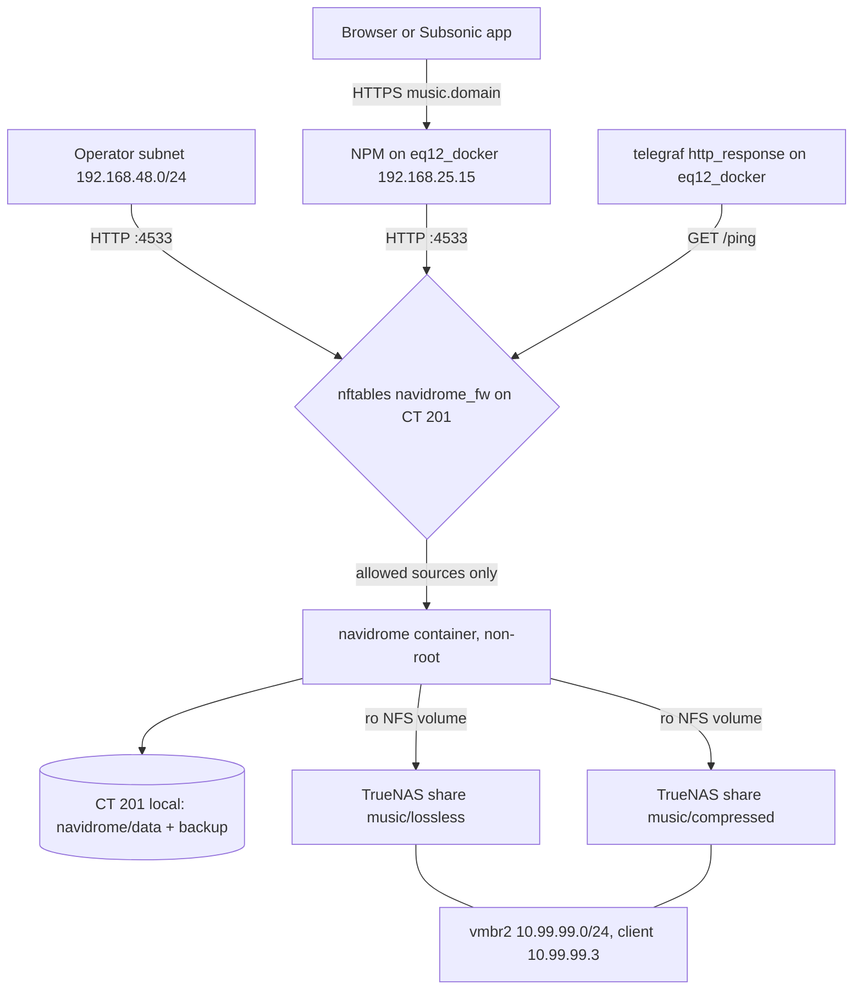
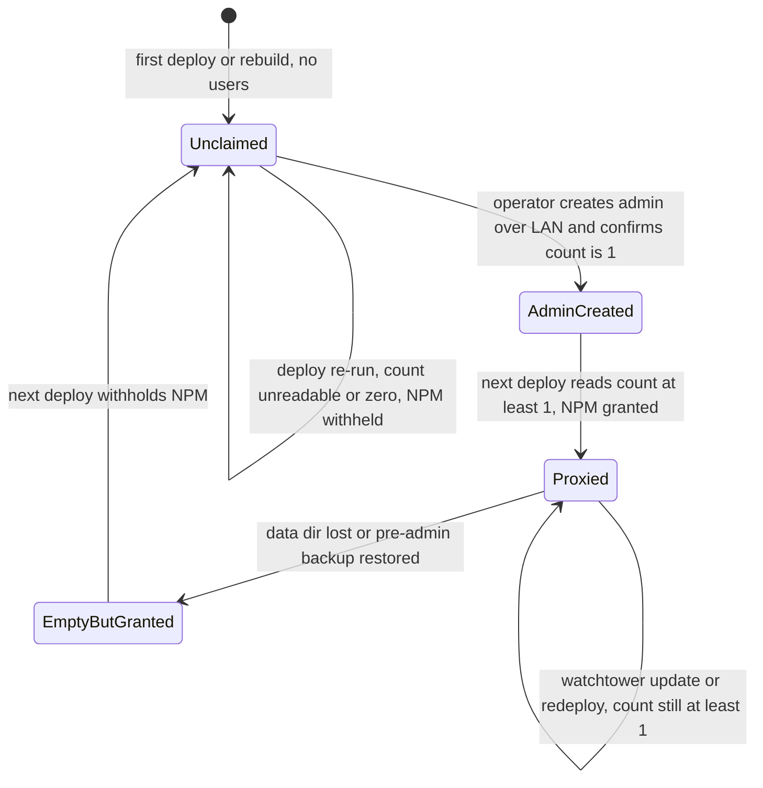

# Navidrome Music Streaming on n5pro_docker - Plan

## Goal Capsule

- **Objective:** The operator can open `music.<domain>` in a browser or a Subsonic app and stream any album from either the lossless or the compressed collection, switching between the two, without any private detail about them or their collection landing in this public repo.
- **Means:** One Navidrome container on n5pro_docker (CT 201) with two read-only libraries over host-only NFS, proxied by the existing NPM, kept current by Watchtower (Key Decisions; KTD1, KTD4, KTD7).
- **Authority:** Product behavior is owned by the R-IDs below; implementation mechanism by the KTDs; CLAUDE.md's Critical Rules and Gotchas override this plan wherever they conflict.
- **Stop conditions:** Stop and report if (a) the TrueNAS compressed share cannot be made to pass the `showmount` check from CT 201 (U1), (b) the NPM cutover of #331 Phase 3 turns out not to have happened (U8 waits on it; everything before the NPM step can still ship), or (c) any step would need a literal private value in a tracked file.
- **Execution profile:** Ansible role plus inventory and doc changes, verified by lint, `--check --diff`, live scoped applies and deliberate guard falsification. Two operator-only steps happen outside Ansible: the TrueNAS share (U1) and the NPM proxy host plus first admin (U8).
- **Who finishes:** The implementer runs this through the `homelab-change-loop` skill (issue, branch, implement, verify, live apply, review, merge). The issue and PR text are public: write `<domain>`, never the literal.

---

## Product Contract

### Summary

Add a `services/navidrome` role and deploy it on n5pro_docker. Navidrome serves two libraries, Lossless and Compressed, each a read-only NFS mount of a sibling folder in the TrueNAS music dataset, and the sidebar library selector switches between them. NPM fronts it at `music.<domain>`, but the firewall admits NPM only after an admin account exists. Watchtower auto-updates it, with Navidrome's own daily database backup as the rollback point.

### Problem Frame

The music collection lives on TrueNAS as `lossless/` and `compressed/` folders inside one dataset (#256). Today the only player is LMS, which serves `lossless/` to Squeezebox-protocol players on the LAN. There is no way to stream from a browser or a phone app, and the compressed copies are not served at all.

Three repo facts shape the work. The repo is public, so the domain, the admin username and anything about the collection must stay out of it (CLAUDE.md rule 3). NPM's proxy hosts live in NPM's own database and are created by hand (`ansible/roles/services/npm/README.md`). TrueNAS NFS shares are created in the TrueNAS UI, and the evidence says `compressed/` is not yet exported to CT 201: the LMS heal script waits for an export line naming `.../music/lossless` itself (`ansible/roles/services/lms/templates/lms-nfs-heal.sh.j2`), while the dataset-root share goes only to the Proxmox host at `10.99.99.1` (`ansible/inventory/host_vars/n5pro/vars.yml`).

Navidrome adds three hazards of its own, all measured against the v0.64.2 source. Whoever opens an empty instance first becomes admin. A library root that cannot be read during a scan marks every track missing while the scan still reports success. And upgrades run one-way schema migrations with no automatic backup first.

### Requirements

**Service and libraries**

- R1. Navidrome runs on n5pro_docker as an Ansible-managed compose service, deployed by `task deploy:service -- --tags navidrome` and by the full pipeline.
- R2. The operator sees two libraries, Lossless and Compressed. The web UI switches between them (or shows both), and Subsonic clients see them as two music folders.
- R3. The container reads only `lossless/` and `compressed/`, read-only. It never sees `originals/` or `audiobooks/`.
- R4. A NAS outage or an empty mount never deletes stars, play counts or playlist entries. Tracks come back intact when the share returns.

**Access**

- R5. The UI and the Subsonic API are reachable at `music.<domain>` through the existing NPM with the existing wildcard certificate. Navidrome's port on CT 201 accepts only NPM's address and the operator workstation subnet.
- R6. Navidrome is never reachable through NPM while it has no admin account. This holds on a first install and on any later rebuild with an empty database.
- R7. Authentication is Navidrome's own login only. Header-based proxy authentication, public share links and anonymous usage reporting are all off.

**Updates and recovery**

- R8. Watchtower auto-updates the container.
- R9. Every image change, whether from Watchtower or an Ansible deploy, lands on a database that was backed up beforehand by the version that wrote it. A restore drill against real listening data has passed, and the role README has its date.
- R14. The README states plainly that losing CT 201's disk, or rebuilding it, loses all stars, play counts and playlists, because the backups sit on the same disk. This is an accepted risk until the deferred off-box copy exists.
- R10. If Navidrome stops answering, for example because NFS was down when Watchtower recreated it, the existing probe alerts fire.
- R11. After a reboot of n5pro, CT 201 or TrueNAS, Navidrome comes back without operator action once NFS is served.

**Privacy**

- R12. No tracked file, issue, PR or comment contains the domain, an account username or any value that identifies the operator or their collection. That includes artist and album names in verification output. Every secret comes from the n5pro_docker vault, and `task lint:vault-leaks` and `task test:vault-leaks` stay green.
- R13. The TrueNAS share settings Navidrome depends on are written down in the role README, because nothing in Ansible manages them.

### Key Decisions

- **One Navidrome instance with two libraries.** Native multi-library (v0.58+) gives the sidebar switch and per-user library access. (session-settled: user-approved — chosen over two instances or one merged library: one login, one database, and duplicate albums stay separable.) Governs R2, R3.
- **Watchtower auto-updates Navidrome.** Navidrome's 2026 advisory cadence (17 advisories in September, four High) favours prompt updates on an exposed service. (session-settled: user-directed — chosen over the repo's monitor-only default for SQLite services: the operator asked for self-updating.) Governs R8, R9, R14.
- **The NPM proxy host and the Compressed library are created by hand in their UIs.** Neither has a supported automation surface: NPM's hosts are DB data the repo never holds, and Navidrome's library API is documented as "not ready". (session-settled: user-approved — chosen over driving NPM's API or Navidrome's unstable library API from Ansible.) Governs R2, R5.
- **The first admin is created over the LAN before NPM can reach Navidrome.** (session-settled: user-approved — chosen over pre-creating the admin through `DevAutoCreateAdminPassword`, which forces the username `admin` and logs the password in plaintext.) Governs R6.

### Success Criteria

- From outside CT 201's LAN segment, `music.<domain>` loads the Navidrome login over HTTPS with the wildcard certificate, and an album from each library plays.
- A Subsonic client (any) lists exactly two music folders and plays from both.
- A second `task deploy:service -- --tags navidrome --limit n5pro_docker` on the converged host reports no changes and leaves the container ID unchanged.
- Watchtower's scan on n5pro_docker reports `scanned=4` (lms, portainer, watchtower, navidrome).
- A backup restored into a scratch container opens, matches the live row counts, and accepts the listener's login.

### Scope Boundaries

- Client app choice, scrobbling (Last.fm, ListenBrainz) and metadata API keys are out of scope.
- LMS is untouched: no edit to its role, heal unit or prefs.
- Access from outside the home network (VPN, port forwarding) is out of scope. `music.<domain>` reaches as far as NPM already reaches today.
- Multi-user setup beyond one non-admin listener account is out of scope.

#### Deferred to Follow-Up Work

- A periodic heal that restarts Navidrome when it is down and NFS is back. Today the alert pages the operator instead (KTD8, KTD9).
- An alert on the log line `Scanner: Target folder does not exist.` from VictoriaLogs, which would catch a mount going empty while `/ping` stays green.
- An off-box copy of `{{ data_mount }}/navidrome/backup` (R14). CT 201's `/data` is not in vzdump (`ansible/inventory/host_vars/n5pro/vars.yml`), so backups share the database's disk. Issue #5305 covers Navidrome writing to NFS directly, so a separate step copying finished backup files to the NAS is still viable.
- A continuous backup-freshness alert, replacing the deploy-time-only check in KTD6.3.
- Correcting the stale `portainer_firewall` comment in `ansible/inventory/host_vars/n5pro_docker/vars.yml` that still names NPM as CT 104 at `192.168.25.20`.
- Automating the TrueNAS NFS share through the TrueNAS API (the repo already has a `truenas_api_client` pin for reporting).

### Sources

- Navidrome v0.64.2 source and docs: multi-library <https://www.navidrome.org/docs/usage/features/multi-library/>, options <https://www.navidrome.org/docs/usage/configuration/options/>, backup <https://www.navidrome.org/docs/usage/admin/backup/>, security <https://www.navidrome.org/docs/usage/admin/security/>, missing files <https://www.navidrome.org/docs/usage/library/missing-files/>, Docker permissions <https://www.navidrome.org/docs/installation/docker/>, advisories <https://github.com/navidrome/navidrome/security/advisories>.
- Navidrome issues: #6471 (SQLite on NFS freezes), #5305 (backups to NFS come out empty).
- Repo learnings: `docs/solutions/runtime-errors/proxmox-boot-order-inversion-breaks-nfs-volume-mount.md`, `docs/solutions/integration-issues/nftables-input-hook-inert-for-docker-published-ports.md`, `docs/solutions/conventions/scoped-nftables-on-live-host.md`, `docs/solutions/conventions/a-falsification-run-must-actually-reach-the-guard.md`, `docs/solutions/integration-issues/watchtower-label-enable-scan-scope.md`, `docs/solutions/integration-issues/compose-up-recreates-watchtower-created-containers.md`.
- Prior plan: `docs/superpowers/plans/2026-11-14-npm-docker-migration.md` (#331).

---

## Planning Contract

### Key Technical Decisions

- KTD1. **Two NFS volumes, one per library folder, never the dataset root.** Each library is a docker `local` NFS volume (`ro,soft`, as `lms` does) mounted at `/music/lossless` and `/music/compressed`. `ND_MUSICFOLDER=/music/lossless` makes Lossless library 1, which Navidrome rewrites from that variable on every start. The parent `/music` is never a library path, because Navidrome does not reject overlapping libraries. Implements R2, R3.
- KTD2. **A dedicated read-only TrueNAS share for `compressed/`, mirroring the `lossless/` share.** It is restricted through the share's Networks field to `10.99.99.3/32` (CT 201 on vmbr2), with Hosts left empty, and copies every Advanced Option from the lossless share. The operator confirmed the lossless share's settings on 2026-11-16:
  - path `/mnt/vault/media/music/lossless`;
  - Networks `10.99.99.3/32`, no Hosts;
  - Read Only;
  - Maproot `root`/`root`;
  - **no Mapall**;
  - default Security.

  Without Mapall, TrueNAS sees each client's own UID. That is why KTD3 runs the container as the files' owner. The alternative was adding CT 201 to the dataset-root share, which would expose `originals/` and `audiobooks/` and the root share's write access. The NFS client is CT 201's own vmbr2 address: Docker mounts the volume in CT 201's network namespace, so a container's `172.x` address never reaches TrueNAS. Implements R3, R13.
- KTD3. **Database and backups live on CT 201's local disk, outside the deploy directory, owned by the container's non-root user.** Paths are `{{ data_mount }}/navidrome/data` and `{{ data_mount }}/navidrome/backup`, siblings of `{{ data_mount }}/deploy/navidrome`, because `_deploy`'s rsync runs with `delete: true` over the deploy dir. The container runs as `navidrome_uid:navidrome_gid` (default `3000:3000`, the library owner; the shares have no Mapall, so this UID is what TrueNAS checks, and U3's in-container library check proves the reads) with `ND_ENFORCENONROOTUSER=true`. The role creates both directories itself, owned by the container user, non-recursively: the data directory at 0750, the backup directory at 0700, because backups hold account usernames. Neither directory may ever be listed in `svc_data_dirs`, which would hand them back to root on every run. SQLite on NFS freezes (#6471) and backups to NFS are empty files (#5305), so neither goes to the NAS. Implements R3, R9.
- KTD4. **Two independent locks keep NPM away from first-admin creation.** Threat model: a visitor coming through NPM claims an empty instance through `POST /auth/createAdmin`, which is unauthenticated and not rate-limited while the user table is empty. Implements R6 and instantiates the first-admin Key Decision.
  1. **Staged NPM grant (deploy-time, affirmative-allow).** The role reads Navidrome's user count before rendering the firewall. NPM's source (`192.168.25.15/32`) joins the allowlist only when the count is positively at least one. A missing database, an unreadable one, a query error or a zero count all withhold the grant, so an empty instance gets a gateway error at NPM: a 504 after nginx's connect timeout, because the firewall drops packets silently. The operator subnet is always allowed, which is how the first admin is created over the LAN.
  2. **NPM refuses the admin-creation endpoint (state-independent).** The proxy host's Advanced config answers `/auth/createAdmin` with a 403 from nginx itself, on every request, forever. This covers what lock 1 cannot see.
     - The grant is decided only when Ansible runs. A data dir lost under the heal unit or Watchtower, or a restore of a pre-admin backup, would otherwise reopen the endpoint until the next deploy.
     - `nft_scoped_fw` tables fail open by design: an unload, flush or failed reload leaves the port open (`ansible/roles/nft_scoped_fw/templates/scoped-firewall.nft.j2`).

  Residuals, accepted and written in the README:
  - Any device in the operator subnet can claim an empty instance during the first-install window. U8 checks who the admin is before granting NPM.
  - `192.168.25.15` is eq12_docker's own address, and every bridged container there egresses from it. So lock 1 admits all of eq12_docker's containers, not only NPM and telegraf, and lock 2 does not stand in their path. In `EmptyButGranted`, the control for those sources is the runbooks' at-least-one-user check before start.

  Not a residual: whether an L2 neighbour on `192.168.30.0/24` can reach the container's bridge address directly, around the `fib` scope guard, is unmeasured. If U4 measures a connection, that violates R5 and is fixed before go-live.
- KTD5. **Pin every Navidrome default whose flip would change safety.** Set explicitly in `env.j2` and the compose file:
  1. `ND_SCANNER_PURGEMISSING=never`, so an empty mount marks tracks missing and never deletes their annotations (R4). It is already the default; the pin exists so an auto-update can never change it underneath us.
  2. `ND_SCANNER_WATCHERWAIT=0` and `ND_SCANNER_SCHEDULE=@every 1h`. inotify cannot see changes made on TrueNAS or from the music workbench, and the hourly quick scan does catch tag edits.
  3. `ND_ENABLESHARING=false` (the default flipped to true in 0.63.0), `ND_ENABLEINSIGHTSCOLLECTOR=false`, and no ExtAuth trusted sources (R7). Setting `ND_EXTAUTH_TRUSTEDSOURCES` to NPM's address would trust a client-supplied `Remote-User` header and auto-create users. Navidrome also reads `ND_CONFIGFILE`, by default inside the data directory that nothing manages, and a config file there could switch ExtAuth on without anyone noticing. So the role asserts that no `navidrome.toml` exists after every deploy.
  4. `ND_AUTHREQUESTLIMIT` and `ND_AUTHWINDOWLENGTH` pinned at their defaults (5 per 20s). The cost is accepted: behind NPM, every remote client shares one rate-limit bucket, so one app with a stale password can lock out the others for 20-second windows.
  5. `ND_TRANSCODING_MAXCONCURRENT` capped at a small number (4), against the ffmpeg denial-of-service the docs warn about.
  6. `TZ` from the inventory `timezone`. The role asserts that `timezone` equals `watchtower_timezone` (both are `America/Los_Angeles` in `ansible/inventory/group_vars/all/vars.yml` today), so the KTD6 ordering cannot drift. If the image cannot resolve the zone, Go silently falls back to UTC and the 03:00 backup moves to the evening. The backup's filename cannot tell these apart, because the container stamps it from its own clock. The falsifier is the first scheduled backup's modification time, read with `stat` on CT 201, which runs in the inventory zone: 03:0x local passes, 19:0x or 20:0x local means the UTC fallback. If it fails, bind-mount the host's `/usr/share/zoneinfo` read-only.
- KTD6. **Every image change lands on a fresh backup.** Implements R9, R14.
  1. **Unattended updates:** Navidrome's built-in backup is the pre-migration snapshot. `ND_BACKUP_PATH=/backup`, `ND_BACKUP_SCHEDULE` at 03:00 local, `ND_BACKUP_COUNT=14`. All three must be set, or Navidrome silently clears the schedule, so the role asserts all three are non-empty before deploying. Watchtower runs at 04:30 local (`watchtower_schedule`), so every unattended update starts at most 90 minutes after a fresh backup, provided the KTD5 time zone holds.
  2. **Ansible deploys:** `_deploy` runs `pull: always`, so any deploy can land a migrating release up to 24 hours after the last 03:00 run. Before `_deploy`, the role pulls the KTD7 image itself and compares its ID with the existing container's `.Image`. Only when they differ and a database exists does it take a pre-deploy backup:
     - If the container is running, it runs `backup create` inside it, using the binary that wrote the database.
     - If the container is stopped or absent, it copies the database and its `-wal`/`-shm` files into the backup directory. This is consistent, because nothing has the file open. It never starts the new image against the database first.

     A converged run pulls nothing new, takes no backup, and can report no changes. The README states how these manual backups get pruned. Scheduled pruning may not count them, so implementation confirms this.
  3. **Freshness:** on a claimed instance, the role asserts the newest existing backup is under 26 hours old. The check runs before the step-2 backup, so it reads only what the schedule wrote. A silent schedule loss between deploys is caught only at the next deploy. A continuous freshness alert is deferred.
  4. **Not DR:** backups share CT 201's disk, which is outside vzdump (R14). A restore also needs the same `ND_PASSWORDENCRYPTIONKEY` (KTD10).

  The vaultwarden/npm-style pre-upgrade gate is not reused, because it would never run under Watchtower.
- KTD7. **Image `deluan/navidrome:latest`, labelled `watchtower.enable=true` without `monitor-only`.** Auto-update needs a moving tag. Navidrome publishes no minor-floating tag, and `0.6` resolves to a 2020 build, so a "minor pin" is not available. `deluan/navidrome` and `navidrome/navidrome` serve identical digests; the long-standing name is chosen and recorded in the role README, because Watchtower watches the exact reference. The watchtower README gains the exception paragraph, citing pgadmin4 as the precedent. (session-settled: user-directed — chosen over monitor-only: the operator asked for self-updating.) Governs R8.
- KTD8. **Navidrome gets its own NFS boot-heal unit, copied from LMS's.** The convention requires one for every docker-local NFS stack, and the LMS unit hardcodes the `lyrion` deploy dir and one export. The copy waits for both exports and matches each `showmount -e` line exactly on its export path, not as a substring: a substring match on `/mnt/vault/media/music` would also match `.../music/lossless`. Deploy and export paths come from role vars, so the device path and the export string stay separate if a library is ever served through a parent export. Extracting a shared helper was rejected because it would edit LMS. Implements R11.
- KTD9. **Liveness rides the existing eq12_docker telegraf HTTP probe.** One URL, `http://192.168.30.15:<port>/ping`, joins `[[inputs.http_response]]`. The three rules in `probe-health.yaml` pick it up without an edit. Probing by IP keeps the domain out of the `server` label. The probe's source is `192.168.25.15`, the same address KTD4 grants, so it goes red during the first-install window and green once the admin exists. Implements R10.
- KTD10. **`ND_PASSWORDENCRYPTIONKEY` comes from vault and is set before the first admin exists.** The default key is public in Navidrome's source, so a leaked database or backup would otherwise reveal stored passwords. Rotating it later locks every user out, so the README marks it never-rotate. The vault key is `vault_navidrome_password_encryption_key` in `ansible/inventory/host_vars/n5pro_docker/vault.yml`. Implements R12.
- KTD11. **No `ND_BASEURL`, pending one check.** A subdomain root needs no prefix, and leaving it unset keeps the domain out of the role entirely. Share links, the one feature that would want a pinned base URL, are off (KTD5). One caveat: since 0.64.0, Navidrome honours forwarded headers only from trusted sources, and that list stays empty. So it may build absolute URLs as `http://…:4533`. U8 checks the UI and a Subsonic stream through NPM. If URLs come out wrong, the fix is `ND_BASEURL` from a new `vault_navidrome_domain` key, never trusted sources, which would switch on header auth (KTD5).
- KTD13. **Private values the vault never holds still get leak coverage.** Implements R12.
  - Account usernames live only in Navidrome's database, so `scripts/check-vault-leaks.py` cannot see them. The vault gains sentinel keys `vault_navidrome_admin_username` and `vault_navidrome_listener_username`, which no config reads; they exist so the guard can match them. Their values must be at least 6 characters, the checker's `MIN_LEN`.
  - Hooks never scan issue or PR text. Every issue, PR body and comment is checked with `task lint:vault-leaks -- --message-file <draft>` before posting.
  - Verification output records counts, never names. Library listings, scan results and album comparisons print counts only, because Ansible echoes stdout at `-v` and on failure.
- KTD12. **Docker subnet `172.30.0.0/24`, the last free n5pro pin.** The fleet-map comment is updated to say n5pro's range is now exhausted and what to do next. The compose network uses the `:?` required form with an explicit network name, like npm.

### High-Level Technical Design

Request and storage paths:



The staged NPM grant (KTD4, lock 1) across the instance's life. NPM's `/auth/createAdmin` refusal (lock 2) holds in every state, which is what covers the window marked "until next deploy".



While in `EmptyButGranted`, lock 2 is all that stands between NPM and admin creation. Nothing stands between eq12_docker's other containers and admin creation (KTD4 residuals). The restore and DR runbooks therefore check for at least one user before starting the container.

Role task order (directional, not a task listing): config asserts, then the `showmount` export preflight, then the user-count read, then `nft_scoped_fw`, then data directories, then the heal unit, then `_deploy`, then the `/ping` readiness gate, then the post-deploy checks.

### Assumptions

- UID 3000 can read both library trees. The CT 201 shares have no Mapall, so the container's own UID reaches TrueNAS. Files the workbench writes land as 3000:3000, because the workbench's root share maps all writes to the library owner, and the workbench stat of 2026-09-05 read 777 at 3000:3000. U3's non-empty-library check run as the container user confirms it.
- The apex DNS record for `<domain>` already points at the new NPM on eq12_docker (`192.168.25.15`), per `docs/architecture.md`, which lists CT 104 as a stopped standby. U8 verifies this before the NPM step.

### Risks and Dependencies

| Risk | Mitigation |
| ---- | ---------- |
| An auto-update runs a one-way migration that breaks the database | The 03:00 backup (KTD6). The rollback runbook (U3) stops the container, restores with a one-off run of the previous exact version, then pins that version and drops the Watchtower label. Watchtower deletes the old image and would re-apply `:latest` at the next 04:30 |
| The backup schedule is silently cleared, or backups stop being written | Deploy-time triple assert and freshness assert (KTD6). Between deploys, undetected until the deferred freshness alert exists |
| The container's time zone falls back to UTC, moving the backup to the evening | The `timezone` equals `watchtower_timezone` assert, plus the host-side modification-time falsifier (KTD5.6) |
| CT 201 disk loss or rebuild | Accepted, stated in the README (R14). Off-box copy deferred |
| Lossless goes missing while Compressed holds a same-suffix, same-MBID file, and the scanner moves the annotations across libraries for good | U8 counts same-suffix overlaps between the libraries and records the number. A non-zero count is recorded as a live risk |
| The operator removes missing files while a share is degraded | The README forbids "Remove missing files", in the UI or via `navidrome missing`, while a share is down |
| Watchtower recreates the container while NFS is down, and it stays down until boot or the next deploy | Detected by the U6 probe. The periodic heal is deferred |
| An empty instance is reachable through NPM | Two locks (KTD4) |
| An auto-update flips a security default | Explicit pins (KTD5). After any minor-version jump, re-run the forged-header and share probes from U8 |
| One remote client with a stale password locks out the others behind NPM | Accepted (KTD5.4). The symptom is written in the README |
| The admin username sits at WARN level in VictoriaLogs | Private infrastructure, never the repo. The README notes it is there for VictoriaLogs' retention period |
| `ND_PASSWORDENCRYPTIONKEY` is rotated or lost | Every login and every restore depends on it. Never-rotate note (KTD10), proved by the U8 restore drill's login |

Dependencies:
- The vault key from KTD10 and the sentinel keys from KTD13.
- The #331 Phase 3 NPM cutover, which gates U8's NPM steps.
- The #127 fresh-allocation gate on CT 201, which runs under `--tags` and must stay green.
- The TrueNAS compressed share (U1).

### Output Structure

```text
ansible/roles/services/navidrome/
├── README.md
├── defaults/main.yml
├── files/compose.yaml
├── tasks/main.yml
└── templates/
    ├── env.j2
    ├── navidrome-nfs-heal.sh.j2
    └── navidrome-nfs-heal.service.j2
```

---

## Implementation Units

### U1. TrueNAS share for compressed/ and the export preflight

- **Goal:** CT 201 can mount `compressed/` read-only, and the share's settings are on record.
- **Requirements:** R3, R13 (KTD2)
- **Dependencies:** none
- **Files:** `ansible/roles/services/navidrome/README.md` (the "TrueNAS shares" section)
- **Approach:**
  1. Read-only check from CT 201: `showmount -e 10.99.99.2`. Record which export lines exist and which hosts each allows.
  2. The operator creates the compressed share in the TrueNAS UI (Shares, NFS, Add). Only the lossless share exists today (KTD2). Settings:
     - path `/mnt/vault/media/music/compressed`;
     - description `Compressed Music for Docker LXC (RO)`;
     - Enabled;
     - Networks `10.99.99.3/32`, Hosts empty;
     - Advanced Options as on the lossless share: Read Only, Maproot `root`/`root`, Mapall empty, Security default.
  3. Re-run the check and record the two music export lines only. Leave other datasets' exports out of the README (KTD13).
  4. Write the README section: both shares' exact settings, who may mount them, and that TrueNAS shares are not Ansible-managed.
- **Execution note:** This is an operator step on the NAS. From CT 201, only read-only diagnostics are allowed (CLAUDE.md rule 1). The real mount test is the first deploy in U8.
- **Test scenarios:**
  - `showmount -e 10.99.99.2` from CT 201 lists a line for `/mnt/vault/media/music/lossless` and one for `/mnt/vault/media/music/compressed`, each allowing `10.99.99.3`.
  - Write the falsifier down before checking: if the compressed line is absent or omits `10.99.99.3`, the share or its Networks entry is wrong. A later `Permission denied` from inside the container instead points at file ownership and modes against the container's UID. There is no Mapall to remap it.
- **Verification:** Both export lines are present, and the README records exactly those two.
- **Measured 2026-11-16 (operator, from CT 201):** `showmount -e 10.99.99.2` lists `/mnt/vault/media/music/compressed 10.99.99.3/32` and `/mnt/vault/media/music/lossless 10.99.99.3/32`, plus the root share `/mnt/vault/media/music 10.99.99.1`. Steps 1–3 are done, and only the README write-up (step 4) remains, landing with U3. The root line is also why KTD8's heal must match export paths exactly: a substring match on `/mnt/vault/media/music` hits all three lines.

### U2. Inventory: placement, subnet, firewall sources, vault key

- **Goal:** n5pro_docker declares Navidrome, its subnet, its allowed sources and its secret.
- **Requirements:** R1, R5, R12 (KTD4, KTD10, KTD12, KTD13)
- **Dependencies:** none
- **Files:** `ansible/inventory/host_vars/n5pro_docker/vars.yml`, `ansible/inventory/host_vars/n5pro_docker/vault.yml`
- **Approach:**
  1. Append `navidrome` to `services:`.
  2. Add `docker_networks.navidrome: "172.30.0.0/24"` and rewrite the fleet-map comment: 172.30 taken, n5pro range exhausted.
  3. Add a `navidrome_firewall` block shaped like `portainer_firewall`, split into always-allowed sources (the operator subnet) and the staged proxy source (`192.168.25.15/32`, NPM and the telegraf probe on eq12_docker). Each entry carries a comment naming the source.
  4. Add `vault_navidrome_password_encryption_key` to the vault with `task vault:edit`: a long random value, never rotated.
  5. Add the KTD13 sentinel keys `vault_navidrome_admin_username` and `vault_navidrome_listener_username` to the vault. Their values are the usernames the operator will create in U8, at least 6 characters each.
- **Patterns to follow:** `portainer_firewall` and the subnet map in the same file. Vault editing per CLAUDE.md.
- **Test scenarios:**
  - `task lint:vault-leaks` passes with the new vault values present.
  - Sentinel falsifier: write a sentinel's value into a scratch untracked file, then run `task lint:vault-leaks -- --message-file <that file>`. The guard reports the key by name. Delete the file afterwards.
  - `task test:vault-leaks` passes.
  - `task ansible:lint` passes on the edited host_vars.
- **Verification:** Lint is green, and the subnet map has no overlapping rows.

### U3. Role core: compose, env, deploy, readiness and post-deploy checks

- **Goal:** `task deploy:service -- --tags navidrome` brings up a non-root Navidrome with both libraries mounted and the KTD5 settings in effect.
- **Requirements:** R1, R2, R3, R4, R7, R8, R9, R12, R14 (KTD1, KTD3, KTD5, KTD6, KTD7, KTD10, KTD11, KTD13)
- **Dependencies:** U1, U2
- **Files:** `ansible/roles/services/navidrome/files/compose.yaml`, `ansible/roles/services/navidrome/templates/env.j2`, `ansible/roles/services/navidrome/defaults/main.yml`, `ansible/roles/services/navidrome/tasks/main.yml`, `ansible/roles/services/navidrome/README.md`
- **Approach:**
  1. In `compose.yaml`: image per KTD7, `user:` from env, both `security_opt` lines, the watchtower `enable` label only, port publish, the KTD1 NFS volumes, the KTD3 local binds, a `/ping` healthcheck using the image's busybox `wget` (confirm the binary with `docker image inspect` and a one-off look before relying on it), and the pinned network.
  2. In `env.j2`: the house quoting header, every value single-quoted, the subnet through `mandatory()`, NFS address and paths from `truenas_hostonly_ip` plus the role's library paths, and the encryption key from vault.
  3. In `defaults/main.yml`: port 4533, uid/gid, library paths and export strings, backup schedule and count, scan schedule, transcoding cap, and an empty `navidrome_firewall` default so a host without an allowlist fails the nft assert.
  4. Pre-deploy steps in `tasks/main.yml`:
     1. Assert config, by name and without printing values: the backup triple and the encryption key are non-empty, and `timezone` equals `watchtower_timezone`.
     2. Run the `showmount` preflight against each export string, failing with a message that points at the README's TrueNAS section.
     3. Create the data and backup directories (KTD3).
     4. On a claimed instance, run the freshness assert (KTD6.3).
     5. Pull the image and, if it differs from the container's, take the pre-deploy backup (KTD6.2).
  5. Deploy: call `_deploy` with `svc: navidrome`, then the `/ping` readiness gate.
  6. Post-deploy checks, run inside the container as its own user, with output as counts only (KTD13):
     - each library root has a non-zero entry count, which catches an empty or unreadable mount that `/ping` cannot see;
     - the container's environment carries all three backup variables;
     - no `navidrome.toml` exists in the data directory (KTD5.3);
     - the landed version, read from the running container, is printed for the README.
  7. README: a "what lives where" table in the npm README style. The second library, users and listening data are Navidrome DB state and never go in the repo. It has these sections:
     - The TrueNAS share spec (U1).
     - First install, in U8's order.
     - Rollback after a bad update, in this order, so the old binary never starts against the migrated database:
       1. Find the previous exact `X.Y.Z` from Navidrome's last startup log line before the update, in VictoriaLogs, and cross-check it against the registry tag list. The Watchtower notification's digest identifies the new, broken image, not the one to return to (CLAUDE.md watchtower gotchas).
       2. Stop the container in the deploy directory.
       3. Copy the database and its `-wal`/`-shm` files aside.
       4. Check the chosen backup: non-zero size and `PRAGMA integrity_check`. On 0.64.2, restore still accepts a file that is not a Navidrome database.
       5. Restore with a one-off run of the pinned old image, using the same binds, user and encryption key.
       6. Confirm at least one user (KTD4).
       7. Only then pin `X.Y.Z` in compose, drop the Watchtower label and deploy.
       8. Un-pin once a fixed release ships.
     - DR with an empty data dir, stating the R14 loss.
     - Never-rotate for the encryption key, which every restore also needs.
     - Changing a library's path: edit the library, never delete and re-add it, because deletion loses its stars and play counts. Changing `ND_MUSICFOLDER` silently repoints library 1, so every Lossless track goes missing.
     - Never "Remove missing files" while a share is degraded.
     - Releases that ask for a full scan after upgrading: the startup quick scan is not a full scan, so trigger one from the UI.
     - Manual-backup pruning (KTD6.2).
- **Execution note:** Mostly config. Prove it with lint, `--check --diff` and the live apply. A first deploy skips compose under `--check`, so the U8 apply is the first real test of every new task.
- **Patterns to follow:** `ansible/roles/services/lms/` (NFS volume, readiness gate), `ansible/roles/services/portainer/` (firewall include, minimal role), `ansible/roles/services/npm/` (README shape, `:?` network), `ansible/roles/services/vaultwarden/templates/env.j2` (quoting).
- **Test scenarios:**
  - `scripts/validate-compose.sh` passes: no bare `$NAME`, and every required `${VAR}` has a matching line in `env.j2`.
  - `task deploy:service -- --tags navidrome --limit n5pro_docker --check --diff` renders `.env` with `diff` suppressed and plans the compose deploy.
  - Falsify the backup assert by running with the schedule overridden to empty via `-e`. It fails at its own `fail_msg`, reports `changed=0`, and never reaches the deploy.
  - Falsify the export preflight by overriding the compressed export string with a nonexistent path. It fails at its own message before the firewall or deploy tasks.
  - After the live apply, `docker exec navidrome id -u` is not 0, and the process would exit at startup under UID 0 because of `ND_ENFORCENONROOTUSER`.
  - After the live apply, the container's view of `/music` holds exactly `lossless` and `compressed`, and neither `originals` nor `audiobooks` exists anywhere under it.
  - Both library mounts reject a write (`touch` inside the container fails with a read-only error).
  - Falsify the time-zone assert with `-e watchtower_timezone=UTC` under `--check`. It fails at its own message.
  - Falsify the no-config-file assert by placing an empty `navidrome.toml` in the data dir through a scratch deploy override. The assert fails, and the file is then removed.
  - Pre-deploy backup, positive path: force an image difference by deploying a pinned older exact tag, then `latest`. The backup appears before the container ID changes.
  - Pre-deploy backup, converged path: a redeploy with no new upstream image creates no file in the backup dir.
  - Falsify the freshness assert: on the claimed instance, override the age threshold to a few minutes. The run stops at its own message, before any pre-deploy backup is taken.
  - The first scheduled backup's modification time, read on CT 201, is 03:0x local (KTD5.6 falsifier).
- **Verification:** The container is healthy, both library roots are non-empty from inside it, and the backup directory holds a scheduled file written at 03:0x local.

### U4. Firewall with the staged NPM grant

- **Goal:** Port 4533 on CT 201 is reachable only from allowed sources, and NPM's address is allowed only once an admin exists.
- **Requirements:** R5, R6 (KTD4)
- **Dependencies:** U2, U3
- **Files:** `ansible/roles/services/navidrome/tasks/main.yml`, `ansible/roles/services/navidrome/defaults/main.yml`
- **Approach:**
  1. Before the `nft_scoped_fw` include, read the user count with `sqlite3 -readonly` inside the running container, since `sqlite` ships in the image. CT 201 has no `sqlite3` binary, so there is no host-side branch: a stopped or absent container reads as not claimed. Run it with `check_mode: false`, register the result, and never fail the play on a probe error.
  2. Derive a boolean `claimed` that is true only when the probe succeeded and returned an integer of at least 1. Every other outcome is false.
  3. Render the ports dict as always-allowed sources plus the staged source when `claimed`. Include `nft_scoped_fw` (`nft_fw_name: navidrome`, default `fib` scope guard, no hairpin) before `_deploy`, as portainer does.
  4. After `_deploy` and the `/ping` gate, if the pre-deploy result was not claimed, probe again. If the count is now at least 1, include `nft_scoped_fw` again with the staged source. This repairs a recovery deploy of a stopped, claimed instance in the same run. A fresh empty instance still reads 0 and stays withheld.
  5. When still not claimed, print a debug message that tells "probe error" apart from "count 0". Only the count-0 case tells the operator to create the admin from the operator subnet and re-run.
- **Technical design:** directional only — `claimed := probe.ok and probe.value is integer and probe.value >= 1`; `ports := {4533: always + (claimed ? staged : [])}`.
- **Patterns to follow:** `ansible/roles/services/portainer/tasks/main.yml` (include shape), `ansible/roles/nft_scoped_fw/defaults/main.yml` (interface). The ignore_errors-plus-register rule from CLAUDE.md applies: `failed_when: false` would make the probe's own failure invisible.
- **Test scenarios:**
  - First deploy, no database yet: the kernel table `inet navidrome_fw` admits `192.168.48.0/24` and does not admit `192.168.25.15`. A `curl` to `192.168.30.15:4533` from eq12_docker times out.
  - After the admin exists, a re-run moves NPM into the table and the same `curl` gets 200 from `/ping`.
  - Fail closed on an unreadable database: run live with the in-container database path overridden to a nonexistent file. The pre-deploy and post-deploy probes both fail, the kernel table loses `192.168.25.15`, the debug message reports a probe error rather than "create the admin", and no file appears at that path. Redeploy normally, and the grant returns.
  - Recovery of a stopped, claimed instance: `docker stop navidrome`, then deploy once. By the end of that same run, the kernel table includes `192.168.25.15`.
  - From a blocked source (the music workbench, `192.168.30.16`), `curl` to port 4533 times out (exit 28) in both states.
  - L2 bypass: from the same neighbour, add a temporary route for the Navidrome bridge subnet via `192.168.30.15`, attempt the container's bridge address on 4533, then remove the route. If it connects, R5 is violated. Extend the table to also drop non-allowlisted sources addressed to `172.30.0.0/24` on 4533, and repeat the attempt until it times out, before U8.
  - Converged second run: the nft file and unit report `ok`, and the table is unchanged.
- **Verification:** Both states have been observed live, with the kernel table read by `nft list table inet navidrome_fw`, never inferred from the template.

### U5. NFS boot heal

- **Goal:** After any reboot, Navidrome starts once both exports are served.
- **Requirements:** R11 (KTD8)
- **Dependencies:** U3
- **Files:** `ansible/roles/services/navidrome/templates/navidrome-nfs-heal.sh.j2`, `ansible/roles/services/navidrome/templates/navidrome-nfs-heal.service.j2`, `ansible/roles/services/navidrome/tasks/main.yml`, `ansible/roles/services/_deploy/tasks/main.yml` (comment only)
- **Approach:**
  1. Copy the LMS script and unit under navidrome names.
  2. Loop readiness over the role's export strings. Each counts as ready only when `rpcinfo` answers and `showmount -e` has a line whose first field equals that export.
  3. Point it at `{{ data_mount }}/deploy/navidrome`.
  4. Install and enable it the way `lms` does.
  5. Add the new script to the `_deploy` comment that lists heal scripts hardcoding `compose.yaml`.
- **Patterns to follow:** `ansible/roles/services/lms/templates/lms-nfs-heal.sh.j2`, `lms-nfs-heal.service.j2`, and the install tasks in `ansible/roles/services/lms/tasks/main.yml`.
- **Test scenarios:**
  - Rendered script passes `bash -n` on CT 201 (its own bash, not the Mac's).
  - On the converged host, `systemctl start navidrome-nfs-heal` exits 0 and leaves the container ID unchanged, since `compose up -d` is a no-op.
  - Falsify the timeout path with a deploy run that overrides one export string to a bogus path and the max wait to 20s. Then start the unit, read its `giving up` message and non-zero exit, and redeploy the real values.
  - The exact-match rule: with only a `/mnt/vault/media/music/lossless` line present, a readiness check for `/mnt/vault/media/music` reports not ready.
- **Verification:** The unit is enabled, and a real CT 201 reboot during U8 or later brings Navidrome back. Record which one proved it.

### U6. Liveness probe

- **Goal:** A dead or unstartable Navidrome pages the operator through the existing probe rules.
- **Requirements:** R10 (KTD9)
- **Dependencies:** U4 (the probe's source is the staged address)
- **Files:** `ansible/roles/services/observability/files/data/telegraf/telegraf.conf`
- **Approach:** Add `http://192.168.30.15:4533/ping` to the `[[inputs.http_response]]` URL list, with a comment naming the service and why it is probed by IP. Deploy with `--tags observability --limit eq12_docker` after U8's grant, and follow the bind-mount restart rule the observability role already implements.
- **Test scenarios:**
  - The probe series for this `server` appears in VictoriaMetrics within a few minutes of the deploy, with `result_code` 0 and status 200. Allow about a minute before reading "absent" as a failure, since ingestion lags.
  - With Navidrome stopped deliberately for a short window, the failing-probe rule reaches pending. Its notification is not sent live unless the operator consents (drill rules in CLAUDE.md). Restart, and the series recovers.
- **Verification:** The series is green, and the alert rule list shows the new `server` instance without any edit to `probe-health.yaml`.

### U7. Documentation and watchtower posture

- **Goal:** The repo's maps and the Watchtower posture table describe Navidrome truthfully.
- **Requirements:** R8, R12, R13 (KTD7, KTD12)
- **Dependencies:** U3, U4
- **Files:** `README.md`, `docs/architecture.md`, `docs/n5pro.md`, `ansible/roles/services/watchtower/README.md`
- **Approach:**
  1. `README.md`: add a row to the CT 201 service table with port 4533, marked allowlisted.
  2. `docs/architecture.md`: deployed list, service placement, the n5pro port table, and the subnet line that still calls 172.30 unassigned.
  3. `docs/n5pro.md`: the CT 201 service list. Generalise the NFS Architecture section from Lyrion-only to both consumers and both heal units.
  4. Watchtower README: Navidrome in the auto row, plus a paragraph like pgadmin4's. It should state:
     - the stack is stateful and runs one-way migrations, and the operator chose auto-update;
     - the 03:00 backup is the rollback point, and the pre-upgrade gate does not run under Watchtower;
     - Watchtower's cleanup deletes the previous image, so a rollback pins an exact tag;
     - the startup quick scan is not the full scan some releases ask for.
- **Test expectation:** none — documentation only. `task lint:vault-leaks` covering the edited docs is the check that matters.
- **Verification:** No doc mentions the domain literal, and every doc that lists CT 201's services includes Navidrome.

### U8. Go-live

- **Goal:** The operator streams both libraries at `music.<domain>`, and every guard has been seen to work live.
- **Requirements:** R2, R5, R6, R8, R9, R10, R12 (Key Decisions; KTD4, KTD6, KTD11, KTD13)
- **Dependencies:** U1 through U7
- **Files:** `ansible/roles/services/navidrome/README.md` (record measured outcomes, dates and the landed version, as counts, never names)
- **Approach:** The order exists so that both KTD4 locks are seen to block through NPM before anything is granted.
  1. Dry-run, then apply: `task deploy:service -- --tags navidrome --limit n5pro_docker`. NPM is withheld (U4).
  2. Confirm the NPM cutover: CT 104 is stopped and `<domain>` resolves to `192.168.25.15`. If not, stop the NPM steps here and wait for #331 Phase 3. Steps 6–8 can still proceed over the LAN.
  3. In NPM's UI, create the proxy host: `music.<domain>`, forward to `n5pro-docker.lan:4533` over HTTP, the existing wildcard certificate, Force SSL and HTTP/2. In Advanced, add the exact-match `/auth/createAdmin` refusal (KTD4 lock 2), `proxy_buffering off;`, and clearing of any client-supplied `Remote-User` header. Confirm with `nginx -T` inside the NPM container that both the refusal and the header clearing land where requests actually pass. A server-level header directive is not inherited by NPM's generated `location /`. The header clearing is defence in depth; the empty trusted-sources setting (KTD5.3) is the real control.
  4. Observe both locks from outside: `music.<domain>` returns a 504 gateway timeout, because lock 1 withholds NPM. A `POST` to `/auth/createAdmin` returns nginx's own 403 page, which is distinguishable from Navidrome's JSON refusal.
  5. From the operator subnet, open `http://192.168.30.15:4533`. The "Create Admin" page must appear. If a login page appears instead, someone else claimed it: stop, wipe the data dir, and start again. Create the admin, then confirm the user count is exactly 1. Navidrome logs the username at WARN, and that log reaches VictoriaLogs (private, never the repo).
  6. Settings, Libraries: add `Compressed` at `/music/compressed`. Create one non-admin listener account with both libraries for phone apps, so the admin login is never stored in a client.
  7. Re-run the deploy. NPM is now granted, and `music.<domain>` shows the login page. This run is also the converged second-run check.
  8. Restore drill (R9). Star a few tracks, play some and build a small playlist, so the counts are non-zero. Take a manual backup and restore it into a scratch path, never the live one. Then check:
     - `PRAGMA integrity_check`;
     - row counts for user, library, media_file, annotation, playlist and playlist_tracks match the live database;
     - a throwaway container with no published port opens the restored file, and the listener can log in. This proves the encryption-key round trip.
  9. Deploy the U6 probe.
  10. Record in the README:
      - the landed version;
      - the Watchtower `scanned=` count from a `--run-once --monitor-only` probe;
      - the restore-drill date;
      - the same-suffix overlap count between the libraries (Risks table).
- **Test scenarios:**
  - Covers the first-admin Key Decision: in step 4, `music.<domain>` returns a 504 and never Navidrome's "create admin" page. The createAdmin probe returns nginx's 403.
  - After step 7, the createAdmin probe still returns nginx's 403, not Navidrome's.
  - Library switch: in the web UI, selecting only Lossless and then only Compressed shows two album counts with no overlap. Selecting both shows their sum. Counts are recorded, titles are not.
  - A Subsonic client logged in as the listener lists two music folders and plays a track from each.
  - Forged header: requests through NPM to `/auth/login` and to a Subsonic `/rest/` endpoint, carrying `Remote-User: <admin username>` and no credentials, are both refused.
  - A share-link request (`/share/...`) returns not-found or disabled.
  - Absolute URLs (KTD11): the UI's stream and cover URLs, and a Subsonic `stream` redirect if any, use `https://music.<domain>`. If not, apply KTD11's fallback.
  - The converged run in step 7 has only the expected NPM-grant change. A further run reports `changed=0`, with the container ID and `.Created` unchanged.
  - Watchtower probe reports `scanned=4` on n5pro_docker.
  - Before posting any issue or PR text about this work, `task lint:vault-leaks -- --message-file <draft>` passes.
- **Verification:** All Success Criteria hold, the restore drill passed, and the README records the measurements with dates.

---

## Verification Contract

| Gate | Command or check | Applies to |
| ---- | ---------------- | ---------- |
| Lint and syntax | `task ci:local` (ansible-lint strict, syntax check, `scripts/validate-compose.sh`) | U2–U7 |
| Privacy | `task lint:vault-leaks` and `task test:vault-leaks`; pre-push hook installed via `task hooks:install` | every unit |
| Dry run | `task deploy:service -- --tags navidrome --limit n5pro_docker --check --diff`; judge any predicted recreate against the same dry run on master, per CLAUDE.md | U3–U5 |
| Live apply | Same command without `--check`; then `--tags observability --limit eq12_docker` for U6 | U3–U6, U8 |
| Guard falsification | Each guard seen red at its own `fail_msg`, with upstream inputs pinned so the run actually reaches it: backup assert, freshness assert, time-zone assert, no-config-file assert, export preflight, staged grant fail-closed and stopped-instance recovery, blocked-source curl, L2 bypass attempt, heal timeout, vault-leak sentinel | U2–U5 |
| Kernel state | `nft list table inet navidrome_fw` read live in both grant states | U4 |
| NPM config | `nginx -T` in the NPM container shows the createAdmin refusal and the header clearing in the location that serves requests; the 403 seen is nginx's, not Navidrome's | U8 |
| Restore drill | Scratch restore with integrity check, row counts against live, and a listener login on a portless container | U8 |
| App-level proof | Library roots non-empty from inside the container (counts only), `/ping` 200, both libraries play, Subsonic folder count | U3, U8 |
| Public text | `task lint:vault-leaks -- --message-file <draft>` on every issue, PR body and comment before posting | all |

---

## Definition of Done

- Every R-ID is met and every Success Criterion was observed live, with dates recorded in the role README.
- Each guard in the Verification Contract has been seen to fail, and the second run on the converged host was clean.
- No tracked file, issue or PR text contains the domain literal, the admin username or other private values. The vault-leak gates are green.
- The TrueNAS share settings, first-install order, rollback and DR runbooks are in `ansible/roles/services/navidrome/README.md`, and the restore drill's date is recorded there.
- Both KTD4 locks were observed blocking through NPM before the grant: a 504, and nginx's own 403 on `/auth/createAdmin`.
- No scaffolding from abandoned attempts remains in the diff, such as unused defaults, commented-out compose keys or a dead heal variant.
